# Mercado

App Android para llevar la cuenta del mercado del hogar contra un presupuesto. Apuntas la cámara
al código de barras y el producto queda sumado; el total y lo que queda del presupuesto se ven
todo el tiempo. Se diseñó con una sola vara: tiene que ser más rápida que ir sumando con la
calculadora del teléfono en el pasillo, con el carrito en una mano.

Todo corre en el teléfono. La app no tiene permiso de internet, no usa cuentas ni servidores, y
guarda los datos en una base cifrada.

<p>
  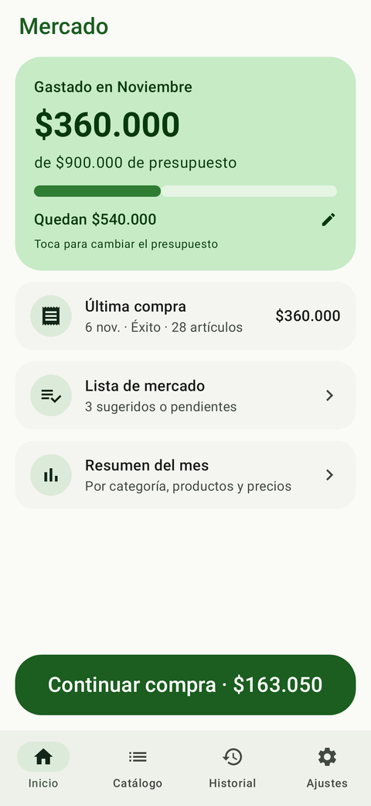
  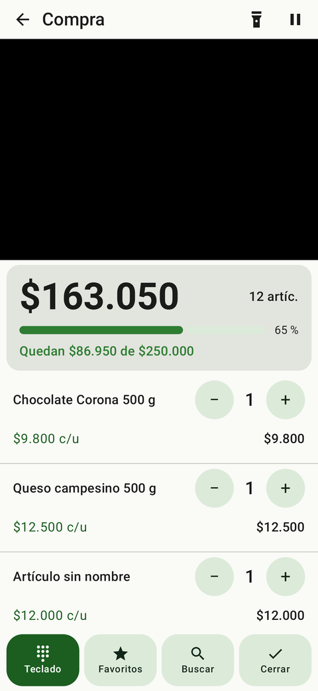
  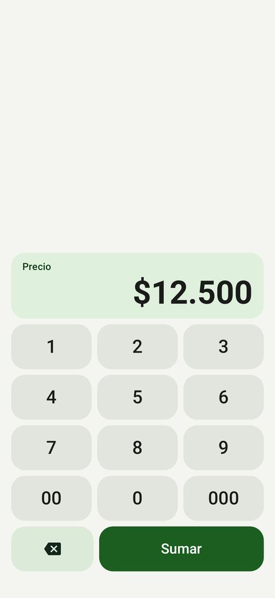
  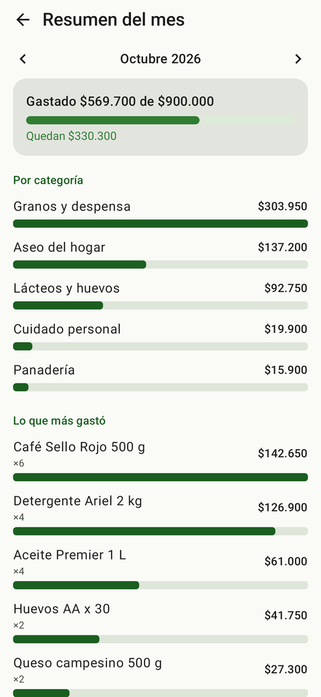
</p>

## Qué hace

- Compra en curso con escaneo continuo: un producto conocido se suma sin tocar la pantalla. El
  total tiene un semáforo (verde, amarillo al 80 % del límite, rojo al pasarlo) y cada acción se
  puede deshacer.
- Teclado de precio propio, con teclas `00` y `000`, para lo que no tiene código.
- Lectura del precio en la etiqueta del estante: prellena el teclado y se confirma con un toque.
- Código desconocido con el precio primero; el nombre se pone después.
- Productos por peso con el precio de la etiqueta de la balanza.
- Catálogo con favoritos, códigos e historial de precios; historial de compras y resumen del mes
  por categoría, productos y variaciones de precio.
- Lista de mercado que se arma sola con la frecuencia de tus compras.
- Recordatorios de mercado y de respaldo.
- Bloqueo con huella o PIN, base cifrada y respaldo cifrado con contraseña.
- Borrado de datos por fechas, por productos o completo, siempre con confirmación.

La guía paso a paso está en [`docs/guia-usuario.md`](docs/guia-usuario.md).

| | | |
| --- | --- | --- |
| 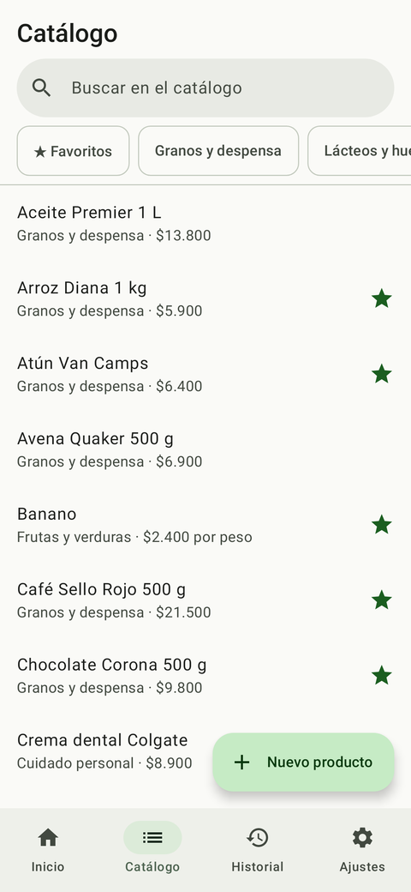 | 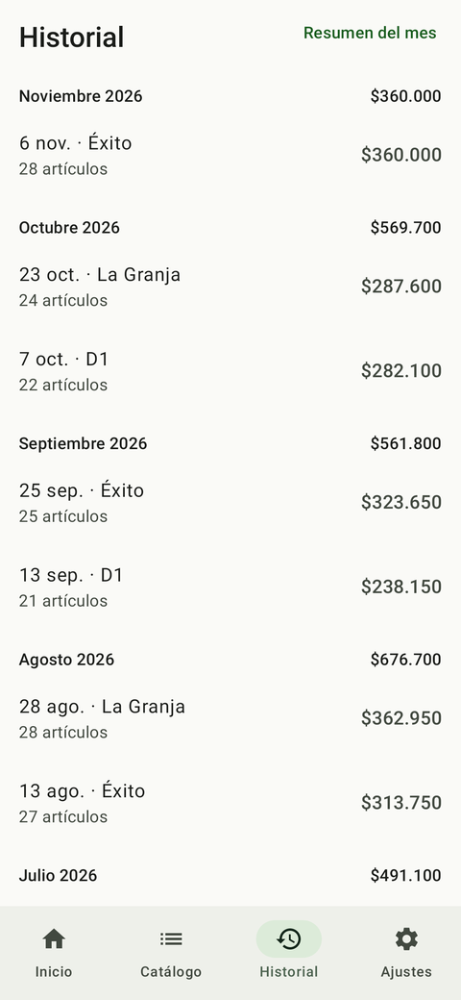 | 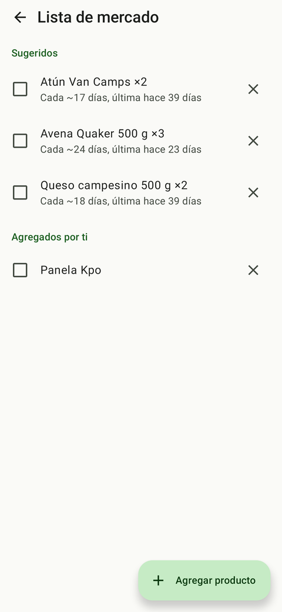 |
| 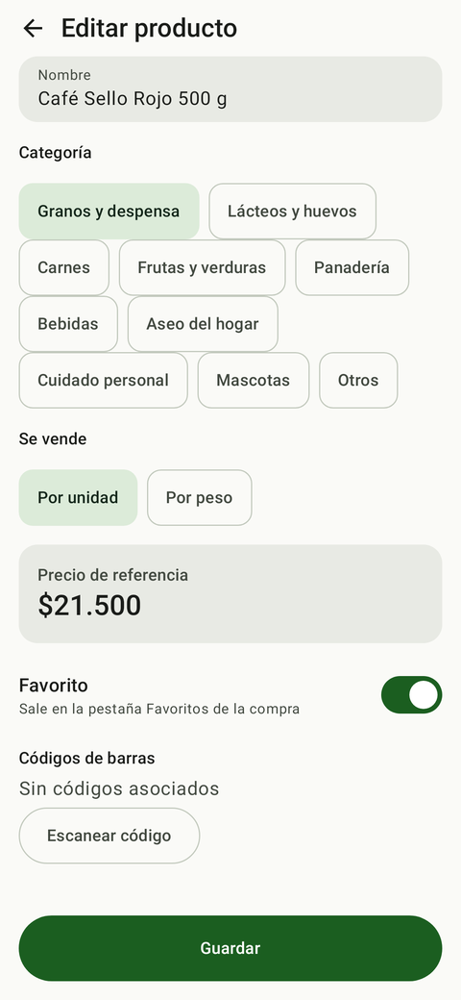 | 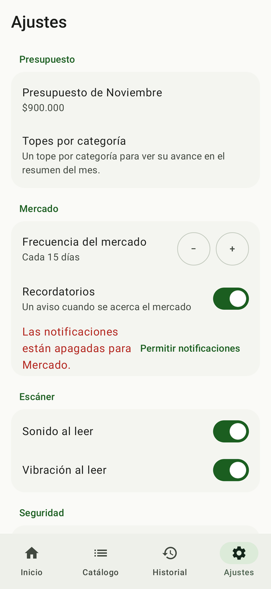 | 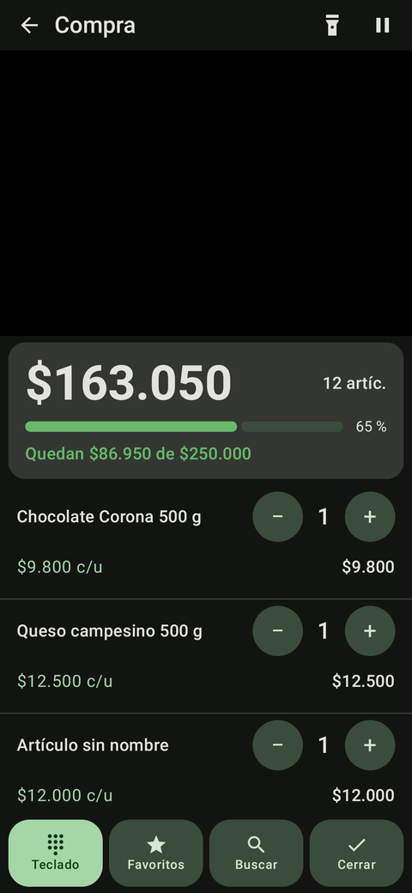 |

Las capturas salen de `ScreenshotsTest`, que dibuja cada pantalla con datos de ejemplo en el PC
(el visor de la cámara aparece en negro porque ahí no hay cámara).

## Arquitectura

Kotlin y Jetpack Compose con Material 3, en dos módulos. `:domain` es Kotlin puro: modelo, reglas
y casos de uso, sin nada de Android, y se prueba en la JVM en segundos. `:app` tiene la interfaz
(MVVM con flujo unidireccional), la base Room cifrada con SQLCipher, la cámara con CameraX y ML Kit,
y la seguridad.

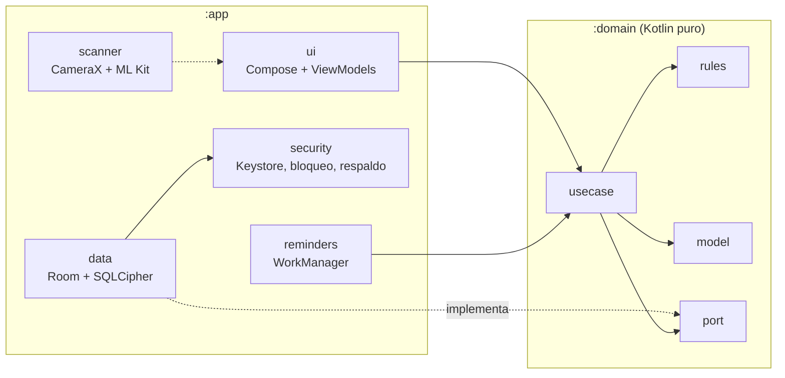

Los diagramas UML completos (componentes, modelo del dominio, secuencia de un escaneo, estados del
bloqueo y flujo del respaldo) están en [`docs/arquitectura-uml.md`](docs/arquitectura-uml.md). Las
decisiones de diseño, con su razón, están en [`docs/02-arquitectura.md`](docs/02-arquitectura.md)
y [`plan/DECISIONES.md`](plan/DECISIONES.md).

| Pieza | Tecnología |
| --- | --- |
| Interfaz | Jetpack Compose, Material 3, Navigation con rutas tipadas |
| Datos | Room 2.8 sobre SQLCipher 4.20, DataStore para ajustes |
| Escáner | CameraX 1.6, ML Kit Barcode Scanning y Text Recognition (incluidos en el APK) |
| Seguridad | Android Keystore, BiometricPrompt, AES-256-GCM, PBKDF2 |
| Tareas | WorkManager |
| Pruebas | JUnit 5 en el dominio; JUnit 4, Robolectric y Compose UI Test en la app |
| Build | AGP 9.5, Kotlin 2.4, Gradle 9.9, R8 en release |

## Seguridad

- El manifiesto de release no tiene `INTERNET` ni `ACCESS_NETWORK_STATE`, aunque ML Kit los declare;
  `scripts/verificar.sh` lo comprueba en cada build.
- La base está cifrada con SQLCipher. Su clave son 32 bytes aleatorios, envueltos por una clave
  AES-256-GCM del Android Keystore que no se puede exportar.
- La app se bloquea con huella o PIN al abrir y al volver después del tiempo de gracia. Mientras
  está bloqueada no se dibuja ninguna pantalla con datos.
- Sin copias automáticas a la nube; la pantalla se puede ocultar en recientes y bloquear capturas.
- El respaldo `.mercado` usa PBKDF2-SHA256 con 600.000 iteraciones y AES-256-GCM, con la cabecera
  autenticada. Al restaurar se valida todo antes de tocar la base.
- Solo hay dependencias de Google Maven y Maven Central, con versiones fijas.

La lista de controles S-01 a S-15, con la evidencia de cada uno, está en
[`docs/05-seguridad.md`](docs/05-seguridad.md) y en la auditoría de `plan/PROGRESO.md`.

## Compilar

Hace falta JDK 17 y el Android SDK con la plataforma 37. En Windows se usa Git Bash.

```bash
./scripts/verificar.sh rapido      # pruebas del dominio + compilación debug
./scripts/verificar.sh completo    # pruebas, lint, APK debug y chequeos de seguridad
./gradlew :app:assembleDebug       # paquete co.daniel.mercado.debug
./gradlew :app:assembleQa          # igual a release, firmada con la llave de debug
./gradlew :app:assembleRelease     # necesita keystore.properties
```

La versión release se firma con una llave propia. Cómo crearla y el formato de
`keystore.properties`, que nunca entra a git, están en [`docs/07-release.md`](docs/07-release.md).

## Instalar

Con el teléfono conectado por USB y la depuración USB activa:

```bash
adb install -r app/build/outputs/apk/release/app-release.apk
```

En HyperOS (Xiaomi, Poco) `adb install` está bloqueado. Esto funciona:

```bash
export MSYS_NO_PATHCONV=1
adb push app/build/outputs/apk/release/app-release.apk /data/local/tmp/mercado.apk
adb shell pm install -r /data/local/tmp/mercado.apk
```

También se puede copiar el APK al teléfono y abrirlo desde el gestor de archivos. Las
actualizaciones se instalan encima, con la misma llave y sin desinstalar, porque desinstalar borra
los datos.

## Respaldar

En Ajustes, "Exportar respaldo" crea un archivo `mercado-AAAA-MM-DD.mercado` cifrado con la
contraseña que elijas (mínimo 8 caracteres). La contraseña no se guarda en ningún lado.
"Restaurar respaldo" muestra la fecha y el contenido del archivo antes de pedir la confirmación, y
reemplaza todos los datos. Conviene exportar antes de cambiar de teléfono o de instalar una versión
nueva.

## Pruebas

```bash
./gradlew :domain:test                  # 106 pruebas del dominio
./gradlew :app:testDebugUnitTest        # pruebas JVM de la app (Robolectric)
./gradlew :app:connectedDebugAndroidTest # cifrado, Keystore, cámara y WorkManager en un teléfono
```

Las pruebas instrumentadas necesitan un teléfono conectado. En HyperOS se instalan con
`adb push` + `pm install` y se ejecutan con `adb shell am instrument`.

## Estructura

| Ruta | Contenido |
| --- | --- |
| `domain/` | Modelo, reglas y casos de uso en Kotlin puro |
| `app/` | Interfaz, datos, escáner, seguridad y recordatorios |
| `docs/` | Producto, arquitectura, datos, UX, seguridad, pruebas, release, guía de uso y UML |
| `plan/` | Plan de trabajo por iteraciones, avance, decisiones y bloqueos |
| `scripts/verificar.sh` | Chequeos de pruebas, lint y seguridad |
| `seed/` | Catálogo inicial en JSON |
| `CHANGELOG.md` | Cambios por versión |

El proyecto se construyó con Claude Code como agente implementador, siguiendo `CLAUDE.md` y
`plan/PLAN.md`: diez iteraciones con una puerta de salida verificable cada una, y pasos de prueba
en el teléfono a cargo del dueño del producto.
