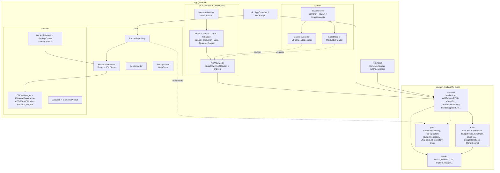
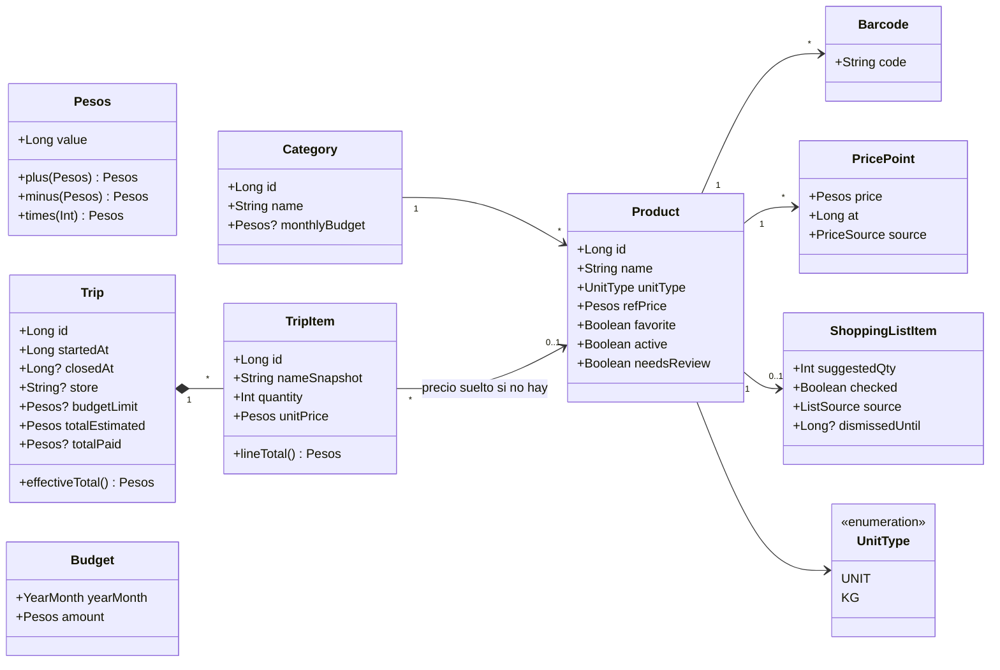
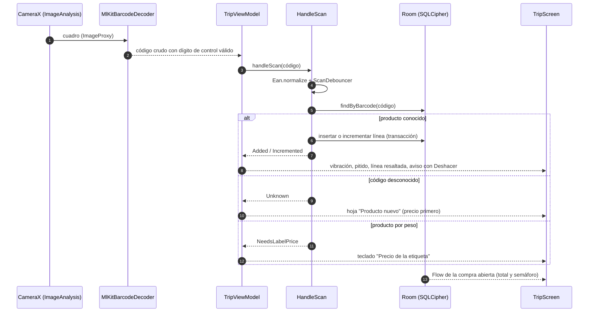
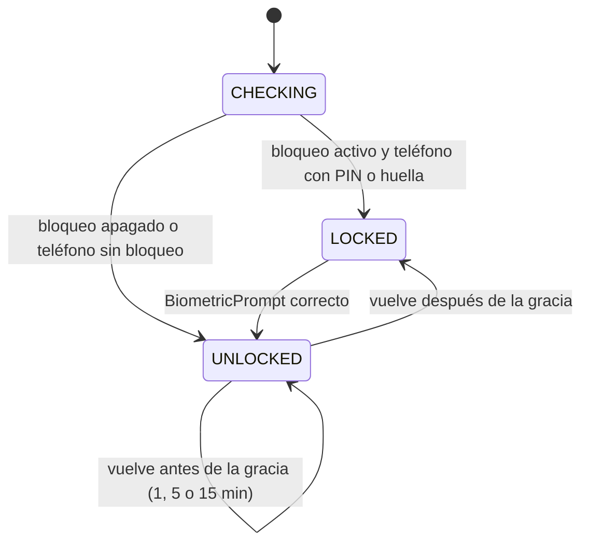
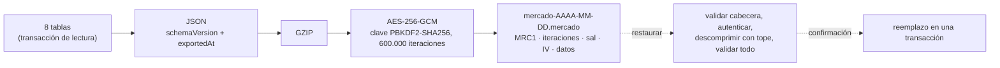

# Arquitectura de Mercado en diagramas

Los diagramas están en Mermaid; GitHub los dibuja directamente. La descripción en texto y las
decisiones cerradas (D-01 a D-22) están en [`02-arquitectura.md`](02-arquitectura.md).

## Componentes y capas

La app tiene dos módulos de Gradle. `:domain` es Kotlin puro y no conoce Android; `:app` tiene la
interfaz, los datos cifrados, la cámara y la seguridad. Las dependencias apuntan siempre hacia el
dominio.

## Modelo del dominio

Los montos son siempre `Pesos` (un `Long` de pesos enteros). Una línea de compra copia el nombre y
el precio del momento, así que el historial no cambia si después se edita el catálogo.

## Flujo de un escaneo

El camino caliente: un código entra en cuadro y queda sumado sin tocar la pantalla. El
antirrebote evita contar dos veces el mismo código mientras sigue en el visor.

## Bloqueo de la app

El bloqueo es una compuerta de interfaz (D-09): la base no depende de la huella. Mientras el
estado no es `UNLOCKED`, la actividad no compone ninguna pantalla con datos.

## Respaldo cifrado

