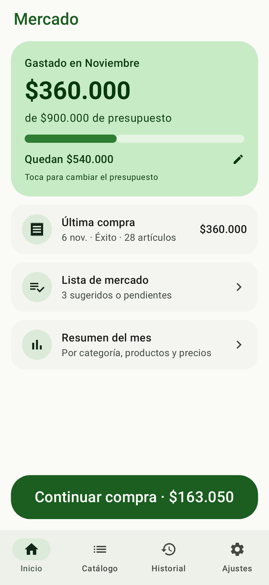
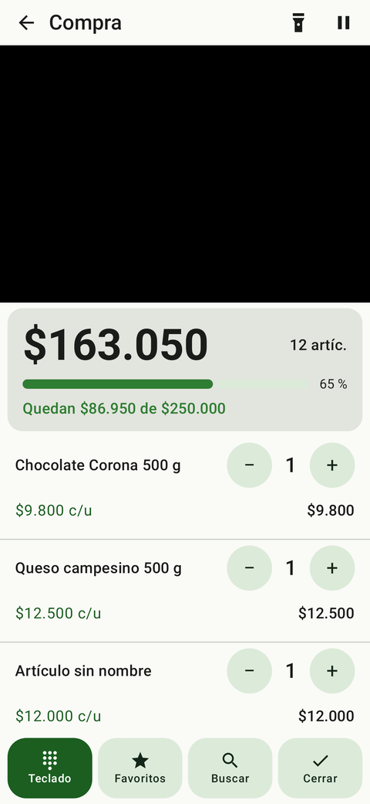
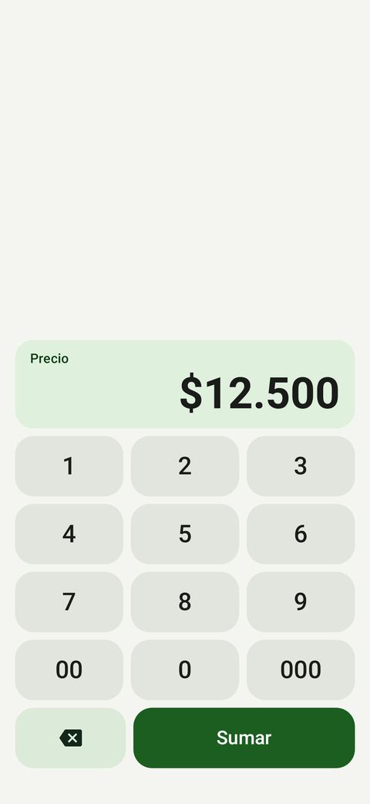
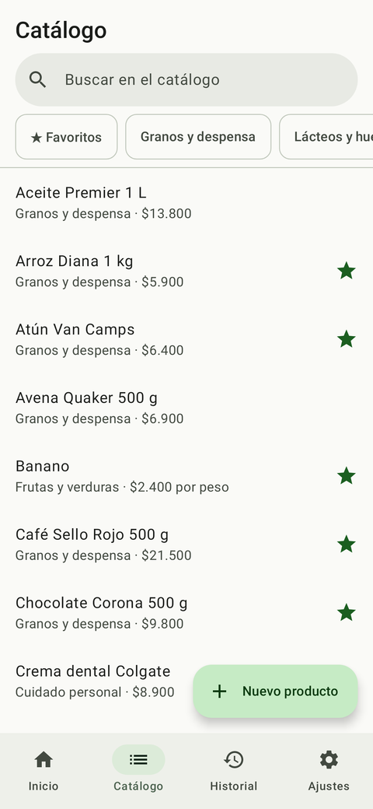
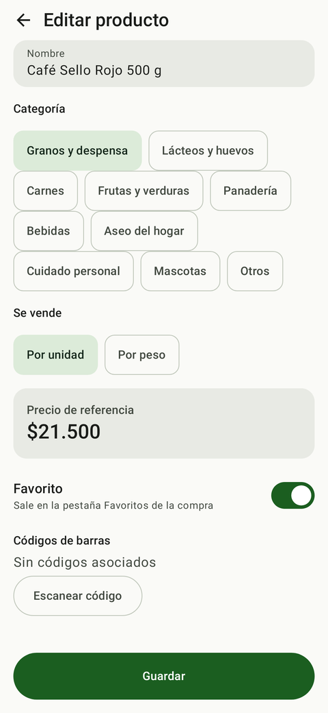
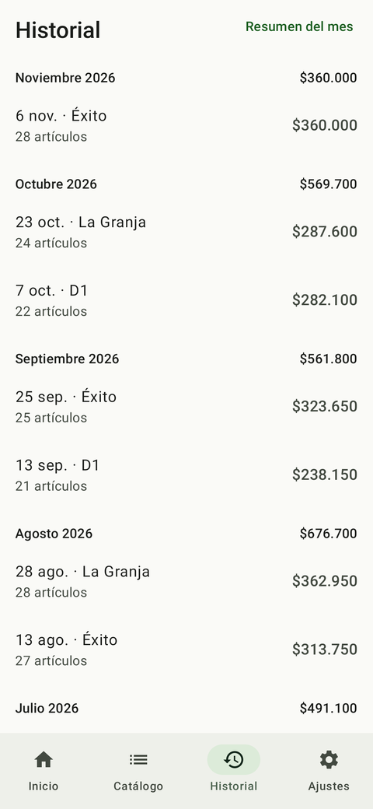
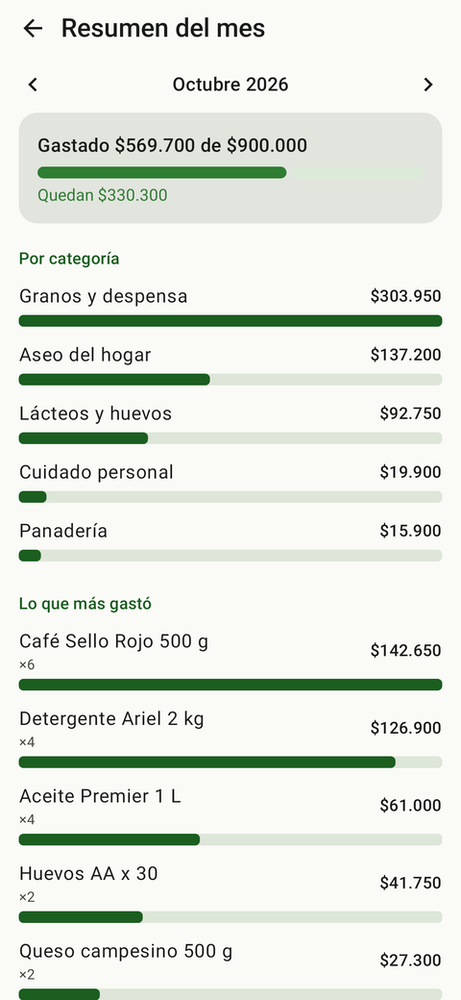
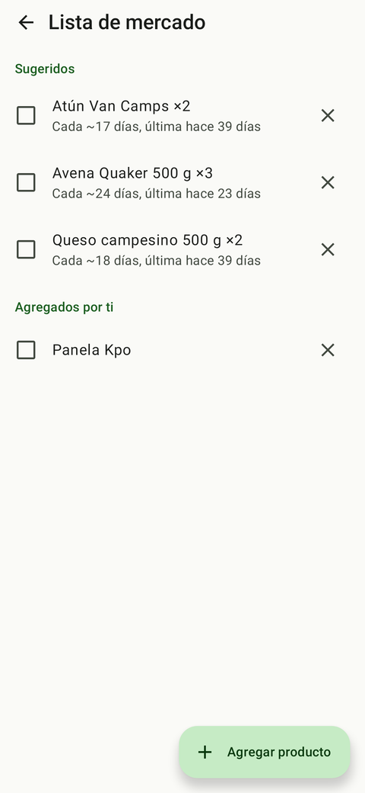
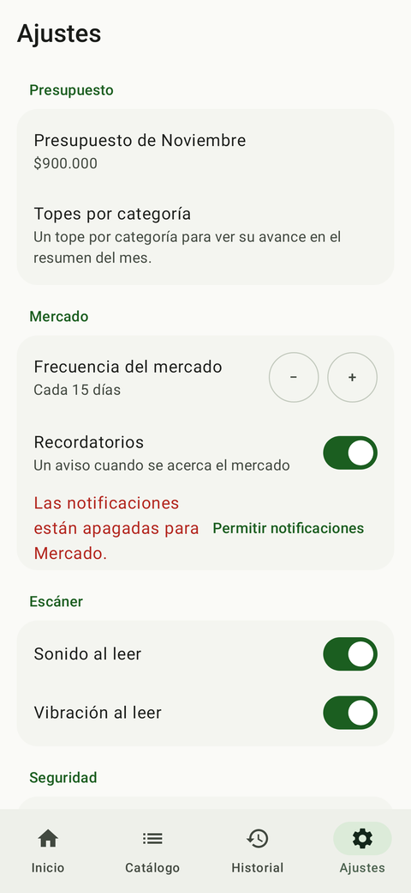
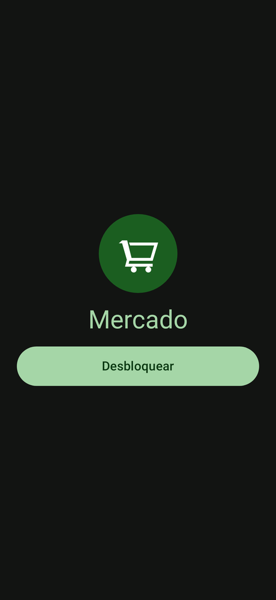

# Guía de uso

Mercado lleva la cuenta del mercado mientras compras. Apuntas la cámara al código de barras y el
producto queda sumado con su precio; arriba ves el total y lo que te queda del presupuesto. Todo
se guarda en el teléfono, cifrado, y la app no usa internet.

## Primer arranque

1. Abre Mercado. Si el teléfono tiene huella o PIN, la app los pide (se puede apagar en Ajustes).
2. El catálogo ya trae los productos del último recibo, con su código y su precio.
3. En el Inicio aparece la tarjeta "Define tu presupuesto del mes". Toca "Definir", escribe el
   monto con el teclado y guarda. Si prefieres no usar presupuesto, toca "Ahora no".

El encabezado del Inicio muestra lo gastado en el mes, el presupuesto y lo que queda. Tócalo para
cambiar el presupuesto. Un mes sin presupuesto propio usa el del mes anterior y lo indica.

## Hacer una compra

Toca "Ir a mercar". La hoja que aparece trae como límite lo que queda del mes; toca "Empezar"
para aceptarlo o escribe otro monto. Con 0 la compra va sin límite. Desde el ícono de la app
también puedes mantener pulsado y elegir "Nueva compra".

La pantalla de la compra tiene arriba el visor de la cámara y la tarjeta del total. La barra se
pone amarilla al pasar el 80 % del límite y roja al superarlo; el teléfono vibra distinto en cada
cruce. Abajo están la lista (lo último arriba) y cuatro botones.

Escanear: apunta al código a unos 15 a 25 cm. Cuando lo lee, el teléfono vibra, suena un pitido
corto y la línea aparece resaltada con un aviso que permite deshacer. Si el producto ya está en
la lista, sube la cantidad.

Teclado: para lo que no tiene código o si la cámara no ayuda. Escribe el precio y toca "Sumar".
La línea queda como "Artículo sin nombre" y puedes nombrarla tocándola.

Favoritos y Buscar: abren una hoja con tus favoritos en cuadrícula, un buscador que encuentra
sin importar tildes y la pestaña Lista con lo que falta de tu lista de mercado. Cada toque suma y
la hoja sigue abierta para echar varios.

Código desconocido: si lees un código que no está en el catálogo, se abre "Producto nuevo" con el
teclado listo. Escribe el precio y suma; el nombre es opcional y se puede poner al cerrar.

Productos por peso: al leer un producto que se vende por peso, la app pide el precio que trae la
etiqueta de la balanza.

### Leer la etiqueta del estante

Sobre el visor hay un selector "Código | Etiqueta". En "Etiqueta" la cámara lee el precio grande
de la etiqueta del estante y, si la etiqueta trae código de barras, también el producto. Se abre
el teclado con ese precio ya escrito: revisa y toca "Sumar". La app nunca suma sola en este modo,
porque leer texto puede confundir un dígito. Cada compra empieza en "Código".

### Corregir

- Toca el precio de una línea para corregirlo; la primera tecla reemplaza el valor anterior.
- Usa `−` y `+` para la cantidad. Llegar a 0 elimina la línea.
- Desliza una línea a la izquierda para eliminarla.
- Toca el nombre para editar la línea (nombre, precio, cantidad o eliminar).
- El aviso de abajo siempre ofrece "Deshacer" sobre la última acción.

La flecha de volver lleva al Inicio sin cerrar la compra. Si cierras la app o el teléfono se
apaga, la compra sigue ahí al volver.

## Cerrar la compra

Toca "Cerrar". Verás el resumen con el total estimado, el límite y la diferencia. Puedes escribir
el total pagado según el recibo (si lo haces, es lo que cuenta como gasto del mes) y elegir la
tienda. Si hubo productos nuevos sin nombre, aparecen en "Ponles nombre". Toca "Guardar compra".
"Descartar compra" borra todo y es la única acción de la app que pide confirmación.

## Catálogo

El catálogo tiene buscador, filtros por categoría, favoritos y "Por revisar". Con el filtro de
favoritos aparecen flechas para cambiar su orden, que es el mismo de la compra. En el editor
cambias nombre, categoría, si se vende por unidad o por peso, el precio de referencia y si es
favorito. "Escanear código" asocia otro código al producto, y abajo está el historial de precios.
Un producto que ya no compras se desactiva; sale de búsquedas y favoritos y se puede reactivar.

## Historial y resumen

El historial agrupa las compras por mes. En el detalle de una compra puedes corregir el total
pagado. El resumen del mes muestra el gasto por categoría (con tope si lo definiste en Ajustes),
lo que más gastaste, qué subió o bajó de precio frente a la compra anterior y los últimos seis
meses.

## Lista de mercado

La lista se arma sola: un producto que compraste al menos dos veces aparece cuando ya pasó cerca
del tiempo que sueles tardar en volver a comprarlo, con la cantidad que sueles llevar. Cada
sugerido dice por qué ("Cada ~28 días, última hace 24"). Puedes agregar productos a mano, marcarlos
o quitarlos; un sugerido que quitas no vuelve hasta su próximo ciclo. Al cerrar una compra, lo que
echaste al carrito queda marcado.

## Ajustes, seguridad y respaldo

- Presupuesto del mes y topes por categoría.
- Frecuencia del mercado y recordatorios. Con los recordatorios encendidos, la app avisa cuando
  se acerca el mercado y una vez al mes recuerda hacer un respaldo.
- Sonido y vibración del escáner.
- Bloqueo con huella o PIN, el tiempo de gracia (1, 5 o 15 minutos antes de volver a pedirlo) y
  la opción de ocultar la app en recientes y bloquear capturas.
- Exportar respaldo, restaurar respaldo e importar un catálogo en JSON.

Para respaldar, toca "Exportar respaldo", escribe una contraseña dos veces y elige dónde guardar
el archivo `mercado-AAAA-MM-DD.mercado`. La contraseña no se guarda en ningún lado: sin ella el
archivo no se puede abrir. Para restaurar, elige el archivo, escribe la contraseña, revisa la
fecha y el contenido que muestra la app y confirma. Restaurar reemplaza todos los datos actuales.

## Problemas frecuentes

La cámara no abre: la app pide el permiso al entrar a la compra. Si lo negaste, toca "Permitir" en
el visor o dalo en los ajustes del teléfono. Sin cámara la compra sigue funcionando con el
teclado, los favoritos y la búsqueda.

No llegan los recordatorios en un Xiaomi o Poco: en los ajustes del teléfono, Apps → Mercado →
Ahorro de batería → "Sin restricciones", y activa el inicio automático. En Samsung, saca Mercado de
"Apps en suspensión".

Cambio de teléfono o reinstalación: exporta un respaldo antes. Desinstalar la app borra los datos,
porque solo existen en el teléfono.
